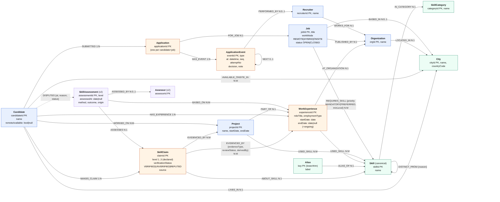
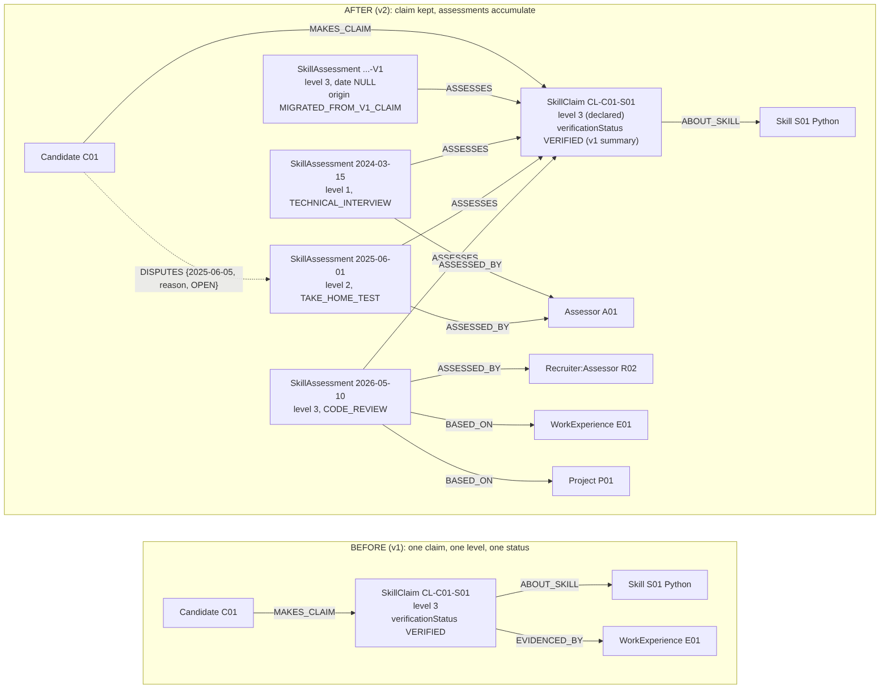

# TalentBridge Property Graph — Project Report (team-XX)

**Course:** Property Graphs and Graph Data Modeling · **Technology:** Neo4j 5 / Cypher · **Data:** fully synthetic

---

## 1. Requirements summary and key assumptions

TalentBridge needs to (a) find candidates by skills, experience, geography and job requirements and (b) **explain** every match. Ten stakeholder statements were turned into business rules BR-1…BR-10 (`requirements-and-cqs.md` §1). The four that shaped the design most:

* **BR-2 / BR-10** – proficiency and verification belong to *one candidate's claim about one skill*, and a claim is not evidence → the claim is a node.
* **BR-4** – "where and when" a skill was used → employment periods and projects are nodes linked to skills.
* **BR-7** – aliases must resolve, look-alikes must not → canonical `Skill` + unique `Alias` keys, exact matching only.
* **BR-9** – application history must survive withdraw/reapply → append-only events.

Main assumptions (full list: `data/assumptions.md`): verification is copied from the source and **never** inferred from employment; *unknown* (no claim / `null`), *unverified* (`UNVERIFIED`) and *verified false* (`REFUTED`) are three distinct states; "now" is a parameter `$asOf = 2026-11-12`; one `Application` per (candidate, job) with `attemptNo` incremented by `REAPPLIED`; the simplified TP geography rule is applied as given.

## 2. Competency questions

The full **CQ analysis matrix** (intent, graph facts, traversal, ambiguities, validation test) for CQ-01…CQ-16 is in `requirements-and-cqs.md` §2. Highlights:

* **Rewritten CQs:** CQ-07 (a remote job has no city, so the original is self-contradictory → "remote-only pool per onsite/hybrid job") and CQ-11 (reference date and overlap semantics made explicit). CQ-03 generalised to `≥ $minMet of N`.
* **"Suitable"** = all mandatory requirements met by a *verified* claim at ≥ minLevel **and** location rule satisfied; preferred skills only explain/rank; job status is reported separately.
* **Three new CQs:** CQ-17 overlapping employment periods, CQ-18 reverse search (jobs a candidate is suitable for), CQ-19 skill supply gap.
* **Stretch CQs implemented:** CQ-13, CQ-15, CQ-16.

## 3. Conceptual and physical model



Colour code: blue = core entities, orange = **reified associations** (claim, experience, application, event), green = shared reference data, dashed purple = change-request additions.

The model has three "spines":

1. **Competence spine:** `Candidate → SkillClaim → Skill ← Alias`, with `SkillClaim → EVIDENCED_BY → WorkExperience | Project → USED_SKILL → Skill`. The claim says *what the person states*, the evidence says *where it was used*, and `verificationStatus` says *what TalentBridge checked*. These three facts are deliberately on three different elements.
2. **Demand spine:** `Organization ← Job → REQUIRES_SKILL {priority, minLevel} → Skill`, `Job → BASED_IN → City`.
3. **Process spine:** `Candidate → Application → HAS_EVENT → ApplicationEvent (NEXT…) → PERFORMED_BY → Recruiter`.

Matching is the intersection of spines 1 and 2 on the shared `Skill` node plus spine-1 `AVAILABLE_ONSITE_IN` against spine-2 `BASED_IN` on the shared `City` node.

## 4. Decision records (summary)

Thirteen records with options, decision, CQs, justification, trade-off and example are in `modeling-decisions.md`.

| # | Concept | Decision | Main CQs |
|---|---|---|---|
| D-1 | Candidate name | property (indexed, not unique) | CQ-01, A-10 |
| D-2 | Skill | shared canonical node + category node | CQ-02/04/10/13 |
| D-3 | Proficiency | property of reified **SkillClaim** node | CQ-01/02/05/09/12 |
| D-4 | Requirement | relationship with properties `{priority, minLevel}` | CQ-02/03/04/12 |
| D-5 | Company | node | CQ-06 |
| D-6 | Work experience | intermediate node per period (+ Project) | CQ-05/06/11/13/17 |
| D-7 | City | shared node | CQ-07, location rule |
| D-8 | Remote preference | boolean property (tri-state); onsite = relationship | CQ-07/12 |
| D-9 | Alias | node with unique normalised key + `DISTINCT_FROM` | CQ-10 |
| D-10 | Application | case node + immutable event nodes | CQ-08/16 |
| D-11 | Proof of skill | `EVIDENCED_BY` from claim to experience/project | CQ-05/09 |
| D-12 | Verification | property of the claim (VERIFIED/UNVERIFIED/REFUTED) | CQ-02/09/12 |
| D-13 | Job title | property (no role taxonomy in scope) | — |

**Controversial choice we defend in the presentation: reifying the skill claim.** The simpler `(c)-[:HAS_SKILL {level, verified}]->(s)` answers CQ-01…CQ-04 in fewer hops. It fails CQ-05 and CQ-09 because evidence must point *to a specific claim*, and in an LPG a relationship cannot be the endpoint of another relationship. It also fails the change request (several dated assessments for one claim). The cost is one extra hop per match, which an index on `verificationStatus` and the uniqueness-backed lookups make negligible at this scale.

## 5. Schema dictionary, identity, time, provenance

See `schema-dictionary.md` for every label, relationship and property with type, requiredness, allowed values and uniqueness. Summary:

* **Identity:** business IDs only (`C01`, `S05`, `J03`); dependent objects use deterministic composite IDs (`CL-C01-S01`, `APP-C02-J01`) so `MERGE` is idempotent. 13 uniqueness constraints (Community), 5 existence/type constraints for Enterprise (commented, with equivalent checks V-10…V-12), 6 indexes.
* **Time:** `DATE` for periods (`endDate = null` = ongoing), `DATETIME` UTC for events, all relative questions parameterised by `$asOf`.
* **Normalisation:** single lookup path `toLower(trim(term))` → `Alias.key` → `Skill`; no fuzzy matching; misses are not auto-created.
* **Provenance:** `source` on every loaded node, `derivedBy` on derived edges, `reviewStatus = POTENTIAL` on automatically linked evidence, `origin` on v2 assessments.

## 6. Loading and dataset extension

Run `01 → 02 → 04 → 03 → 05` on an empty Neo4j 5 database (`README.md` gives Browser, cypher-shell and Python options). `02_load_data.cypher` contains the CSV rows inline as `UNWIND` lists, so no `import/` folder setup is needed; derived structure (evidence links, `seq`, `attemptNo`, `NEXT`) is rebuilt on each run. **Loading twice leaves counts unchanged: 149 nodes / 308 relationships.**

Extension (`data/assumptions.md` §3): +4 candidates, +2 organizations, +3 jobs, +5 skills, +5 experiences (+3 projects), +16 claims, +9 events, +2 recruiters, covering every required tricky case: duplicate name (C01/C07 "Amina Idrissi"), mergeable alias (Spark vs SPARQL; JS vs Java), overlapping experiences (C08), unverified mandatory claim (C09 Spark for J05), reapplication (C09/J05) and status reversal (C10/J06 Rejected → Reinstated), plus a refuted claim and an unfillable job (J07).

## 7. CQ coverage and test results

Parameters default to `candidateId C01, jobId J01, skillTerm Python, requiredTerm Python, preferredTerm Docker, minMet 2, asOf 2026-11-12`. "Result" = what our run returned on the full dataset (see §11 on how it was executed).

| CQ | Graph pattern (abridged) | Fixture → expected result | Negative / edge test (must NOT appear) | Result |
|---|---|---|---|---|
| CQ-01 | `(c)-[:MAKES_CLAIM]->(cl)-[:ABOUT_SKILL]->(s)` | C01 → Neo4j 3 V, Python 3 V, Cypher 2 V, Docker 1 **UNVERIFIED** | no skill of another C01 (C07 "Amina Idrissi"): SPARQL/RDF/TypeScript absent | ✅ |
| CQ-02 | mandatory reqs ← verified claims with level ≥ min; met = total | J01 → C01 (3/3, locationOk true); J02 → C03; J03 → C02, C06; J05 → C08; J06 → C10 | J01 must not return C02 or C05 (Neo4j unverified); J04 and J07 return nothing | ✅ |
| CQ-03 | all mandatory × candidates, OPTIONAL claim, reasons | J01 → C01 3/3; **C08 2/3, missing "Neo4j (no claim)"** | C02 (1/3) and C05 (1/3) excluded at minMet 2; with J05 & minMet 1, C09 shows "Apache Spark (unverified)" | ✅ |
| CQ-04 | Alias→Skill ← `REQUIRES_SKILL{MANDATORY}` ← OPEN job → `{PREFERRED}` → Skill | Python/Docker → J01, J02 | J03 (Python only preferred), J05 (no Docker), J04 (closed); `requiredTerm = Java` returns 0 rows (no JavaScript leak) | ✅ |
| CQ-05 | `(cl)-[:EVIDENCED_BY]->(e)` + org | C01 / "Python 3" → E01 Atlas Data Labs 2024-01-01…2025-12-31, P01 (POTENTIAL) | C01 / Docker → claim row with null evidence; C08 / Cypher → verified but no evidence | ✅ |
| CQ-06 | `(c)-[:HAS_EXPERIENCE]->(e)-[:AT_ORGANIZATION]->(o)` | C08 → E08 FULL_TIME 2023-01-01…2025-06-30, E09 FREELANCE 2024-03-01…2024-12-31 (both kept) | C02 → E02 with endDate null, ongoing = true (not a fake end date) | ✅ |
| CQ-07 | OPEN job `BASED_IN` city; remote candidates `NOT (c)-[:AVAILABLE_ONSITE_IN]->(city)` | J01/Rabat → C02, C03, C07, C09 (16 rows over J01, J03, J05, J06) | C01, C05, C08 (available in Rabat) and C04, C06, C10 (not remote) never listed for J01 | ✅ |
| CQ-08 | Job ← Application → events; distinct candidates per type | J01 → applied 2, withdrew 1, reapplied 1; J05 → 2/1/1; J04, J07 → 0/0/0 | C02 counted once in "applied" despite 2 attempts; review events not counted as applications | ✅ |
| CQ-09 | claims with status ≠ VERIFIED or no `EVIDENCED_BY` | 8 rows incl. C05 Neo4j (unverified), C09 JavaScript (**verified FALSE**), C08 Cypher (verified, provenance gap) | C01 Python, C03 ML (verified + evidence) absent | ✅ |
| CQ-10 | `(:Alias {key})-[:ALIAS_OF]->(s)`, `DISTINCT_FROM` | ML, "machine learning", "Machine Learning" → S05; JS → S08; Spark → S10 | Java → S07 only; "Py" → no skill (no fuzzy match) | ✅ |
| CQ-11 | `(c)-[:HAS_EXPERIENCE\|WORKED_ON]->(x)-[:USED_SKILL]->(s)`, period overlaps window | C01 (E01, P01), C02, C03, C05, C08 (E08, E09) | C09 (Python only in 2022) excluded; C04 (no Python) excluded | ✅ |
| CQ-12 | each requirement + OPTIONAL claim → outcome; location | see §8 | C05/J04 must be REJECT although RDF verified | ✅ |
| CQ-13 | Project → Programming skill ∧ Graph-database skill | C01 / P01 (Python + Neo4j) | C07 / P03 (SPARQL + RDF: RDF is not a graph database category) | ✅ |
| CQ-15 | per job, set of SUITABLE candidates is empty | J04 (closed), J07 | J01…J03, J05, J06 each have ≥ 1 suitable candidate | ✅ |
| CQ-16 | Recruiter ← `PERFORMED_BY` ← event ← application | 4 rows in time order: R02 SHORTLIST C01 J01; R01 REJECT C10 J06; R01 SHORTLIST C08 J05; R02 REINSTATE C10 J06 | candidate self-actions (APPLIED, WITHDRAWN) not attributed to a recruiter | ✅ |
| CQ-17 | two experiences of one candidate with overlapping periods | C08: E08/E09 overlap 2024-03-01…2024-12-31 | C02 (single job) absent | ✅ |
| CQ-18 | reverse of CQ-02 + location | C08 → J05; C02 → J03 | C02 not → J01 (skills) or J02 (Python 2 < 3) | ✅ |
| CQ-19 | mandatory skills in OPEN jobs vs. verified holders | Spark, Kubernetes, ML, Neo4j, SPARQL: 1 holder each; Python: 3 jobs / 6 holders | RDF counted for J07 only (J04 is closed) | ✅ |

**Baseline assertions (TP §8.1) and quality checks (TP §8.2)** — `04_validation.cypher`, all `passed = true`:

| Test | Detail returned |
|---|---|
| A-1 J01: C01 yes, C02 no | `['C01']` |
| A-2 J02: C03 yes, C01 lacks ML | `['C03']` |
| A-3 J03: C02 and C06 meet SQL + Casablanca | `['C06','C02']` |
| A-4 J04: C05 not qualified, job closed | `met 1/2, status CLOSED` |
| A-5 C02/J01 order | `['APPLIED','WITHDRAWN','REAPPLIED']` |
| A-6 ML → Machine Learning; Java ↛ JavaScript | `{ml:['Machine Learning'], java:['Java']}` |
| A-7…A-10 (team) | Spark ↛ SPARQL; C09 rejected for unverified Spark; C10 reversal kept; two Amina Idrissi |
| V-01…V-12 | no duplicate skills, each alias → 1 skill, one requirement per job/skill, no orphan events, look-alikes share no alias, no applications to closed jobs, valid periods, one claim per pair, **rerun counts identical (149/308)**, domain values, job city rule, events sequenced |

**Query plans (TP §8.2).** *P-1 (CQ-02):* with `job_id_unique` the plan starts with `NodeUniqueIndexSeek(Job.jobId)` and then expands; without it, `NodeByLabelScan + Filter`. Starting from the job (few requirements) rather than from all candidates keeps the expansion proportional to the requirements, not to the profile count. *P-2 (CQ-09):* `verificationStatus <> 'VERIFIED'` cannot use a range index (inequality ⇒ label scan + filter); rewriting to `verificationStatus IN ['UNVERIFIED','REFUTED']` allows `NodeIndexSeek` on `claim_status_idx`. On 149 nodes both plans are instantaneous; we only claim the *plan shape* changes, not a measured speed-up.

## 8. Example match explanations (CQ-12)

| Candidate · Job | Met mandatory | Unmet mandatory | Preferred | Location | Verdict |
|---|---|---|---|---|---|
| **C01 · J01** Graph Data Engineer (hybrid, Rabat) | Python 3≥2, Neo4j 3≥2, Cypher 2≥2 (all verified, evidence E01/P01) | — | Docker: claim is *unverified* (level 1), so not counted | available in Rabat ✓ | **SUITABLE** |
| **C05 · J04** Knowledge Graph Specialist (remote, closed) | RDF 3≥2 | **Neo4j: unverified claim (level 2)** | — | remote ✓ | **REJECT: mandatory skill gap** (and the job is closed) |
| **C09 · J05** Big Data Engineer (hybrid, Casablanca) | Python 3≥2 | **Apache Spark: unverified claim (level 3)** | SQL ✓; Kubernetes: no claim | Agadir only ✗ | **REJECT: mandatory skill gap**; location also fails |
| C02 · J01 | Python 2≥2 | Neo4j: no claim; Cypher: no claim | Docker ✓ (3≥1) | Casablanca only ✗ | REJECT: mandatory skill gap |

The C09 case shows why level and verification are independent: C09 *declares* advanced Spark, more than J05 asks, but the claim is unverified, so it cannot satisfy a hard requirement. The explanation tells the recruiter exactly what to verify next.

## 9. Change request: proficiency over time (Phase G)



**1. Assumptions that no longer hold.** (a) One level per candidate-skill (`SkillClaim.level` was "the" proficiency). (b) Verification is a single timeless status without author. (c) Evidence is attached only to claims, not to a judgement. (d) Disagreement did not exist.

**2. Minimal evolution.** Keep everything; add `:SkillAssessment {assessmentId, level, assessedAt, method, outcome, origin}` linked `ASSESSES → SkillClaim`, `ASSESSED_BY → :Assessor` (a recruiter can simply get the extra `:Assessor` label), `BASED_ON → WorkExperience | Project`, and `(Candidate)-[:DISPUTES {at, reason, status}]->(SkillAssessment)`. `SkillClaim.level` is reinterpreted as the *declared* level; `verificationStatus` stays as the v1 summary so **every v1 query and test still runs unchanged**. One constraint and one index are added.

**3. Before/after** for C01 · Python: figure above (v1: one claim with level 3 VERIFIED; v2: same claim + 1 migrated undated assessment + assessments of 2024-03-15 level 1, 2025-06-01 level 2 (disputed), 2026-05-10 level 3).

**4. New CQ (CQ-H1):** *"What was candidate X's assessed proficiency in skill S as of date D, who assessed it, on what evidence, and is it disputed?"* Policy: latest **dated** assessment with `assessedAt ≤ D`.
```cypher
MATCH (:Alias {key: toLower(trim($skillTerm))})-[:ALIAS_OF]->(s:Skill)
MATCH (c:Candidate {candidateId: $candidateId})-[:MAKES_CLAIM]->(cl:SkillClaim)-[:ABOUT_SKILL]->(s),
      (sa:SkillAssessment)-[:ASSESSES]->(cl)
WHERE sa.assessedAt IS NOT NULL AND sa.assessedAt <= $asOf
WITH c, s, sa AS latest ORDER BY sa.assessedAt DESC LIMIT 1
OPTIONAL MATCH (latest)-[:ASSESSED_BY]->(who:Assessor)
OPTIONAL MATCH (latest)-[:BASED_ON]->(x)
OPTIONAL MATCH (c)-[d:DISPUTES]->(latest)
RETURN c.candidateId, s.name, $asOf AS asOf, latest.level AS level, latest.assessedAt AS assessedAt,
       who.name AS assessor, latest.method AS method,
       collect(DISTINCT coalesce(x.experienceId, x.projectId)) AS evidence, count(d) > 0 AS disputed;
```
Results: as of 2025-01-01 → level 1 (Leila Mansouri, technical interview, E01); as of 2026-11-12 → level 3 (Yassine Amrani, code review, E01 + P01). CQ-H2 lists the full timeline including the disputed 2025 assessment and the undated legacy one. Test T-H1 passes.

**5. Property, relationship or node?** A **node**. An assessment has its own identity, date, author, method and evidence, there are many per claim, and a candidate must be able to point a `DISPUTES` relationship *at it*. None of that is possible for a property, and a relationship cannot be the target of `DISPUTES` or the source of `BASED_ON`.

**6. Migration.** For every v1 claim with an outcome (`VERIFIED`/`REFUTED`), create one assessment `ASM-<claimId>-V1` with the v1 level (null if refuted), `outcome` = old status, **`assessedAt = null`, no `ASSESSED_BY` edge, `method = 'UNKNOWN'`, `origin = 'MIGRATED_FROM_V1_CLAIM'`**. Unknown assessor/date are never invented; undated assessments are excluded from "as of" logic and listed last in timelines. `UNVERIFIED` claims get no assessment (nothing was assessed). No claim, event or assessment is deleted; disputes are recorded, not resolved by deletion.

## 10. Limitations and alternatives

**Limitations.** (1) Skill hierarchy is flat: a job asking "graph databases" will not match Neo4j unless a `BROADER_THAN` taxonomy is added. (2) Alias resolution has no fuzzy recall; new spellings need curation. (3) The geography rule is the simplified TP rule (no commuting distance, no hybrid days). (4) Requirements are not versioned (stretch CQ-14 not covered): changing a `minLevel` overwrites it. (5) Matching is boolean; there is no score, which is intentional given the out-of-scope note on sensitive ranking. (6) Automatic evidence links only use exact skill identity; free-text CVs are out of scope.

**Alternative 1 – `HAS_SKILL` relationship with properties instead of a `SkillClaim` node.** Simpler and faster for CQ-01…04 and closer to many tutorials. Rejected because evidence and assessments must reference a specific claim (CQ-05, CQ-09, change request).

**Alternative 2 – `APPLIED_TO` relationship with a `history` list property** (or one relationship per event). A list keeps history on one edge but cannot be indexed, cannot point to a recruiter, and is rewritten on every change; one relationship per event loses the notion of an application "case" and makes attempts hard to count. Rejected in favour of `Application` + `ApplicationEvent`.

(Also considered: `REQUIRES` and `PREFERS` as two relationship types — clearer to read, but every "all requirements of the job" query would need `[:REQUIRES|PREFERS]` and the priority would be implicit in a type name, which is harder to version.)

## 11. Execution and verification note

All scripts are written for **Neo4j 5.x**. During development the load, CQ, validation and change-request scripts were executed end-to-end on an openCypher engine (FalkorDB) with only two mechanical substitutions done by the test harness: `datetime('…Z')` → `localdatetime('…')` and `duration.inMonths(...)` stubbed in CQ-06 (both are standard Neo4j functions). Constraint/index DDL is Neo4j-specific and was not executed there. Results in §7–§9 come from that run; `tools/run_all.py` reproduces the full run on Neo4j.

## 12. Individual reflection (template answers — personalise before submitting)

1. **Hardest node-vs-property decision:** proficiency. As a relationship property it answered CQ-01–04; **CQ-05 / CQ-09** (evidence for *a claim*) forced it onto a claim node.
2. **At 10 million profiles:** we would stop materialising `EVIDENCED_BY` by a global rule (compute it incrementally at ingestion), add a skill-centric pre-filter (start matching from the rarest mandatory skill, CQ-19 statistics), keep `Alias` lookup in a full-text/search service for recall, and consider a `(Candidate)-[:HAS_VERIFIED_SKILL {level}]->(Skill)` shortcut maintained by a trigger for the hot matching path, while keeping claims as the source of truth.
3. **A fact we cannot answer reliably:** whether a candidate is *currently* employed — an open-ended `endDate` may simply be stale data, and we have no "last confirmed" date.
4. **Claim vs. evidence:** the claim is a node with the declared level and a verification status; evidence is a separate experience/project node linked to that claim with `reviewStatus = POTENTIAL`. Linking evidence never changes the status.
5. **Lesson of the change request:** because the claim was already a node, the evolution was purely additive — new nodes pointing at existing claims, no migration of v1 queries. Reifying the concepts that carry business meaning (claims, applications) is what made the model ready for questions we had not been asked yet.
